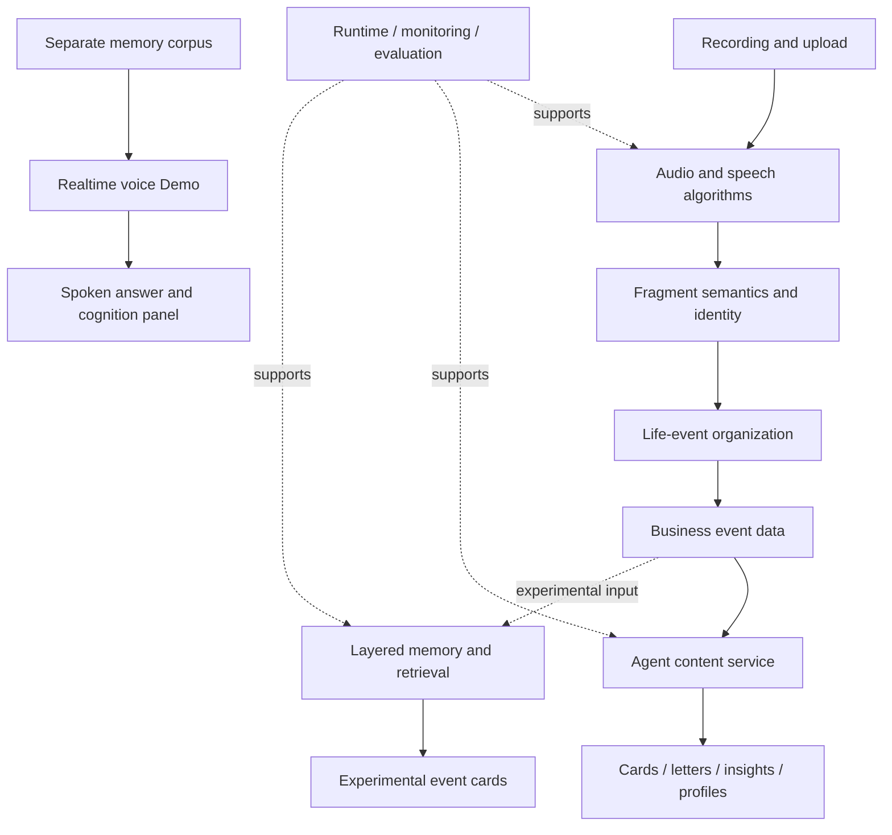

# Spiro | An AI Platform from Everyday Audio to Personal Memory

English · [中文](README.md)

**Turning everyday experiences into personal memories that can be revisited, understood, and discussed.**

Spiro is an AI engineering project spanning audio perception, event understanding, Agent-based content generation, memory research, and interactive experiences. It identifies speech and speakers, organizes meaningful life events, and transforms scattered material into readable content such as event cards and insight letters.

The project also includes asynchronous execution, model routing, output validation, monitoring, human evaluation, and full-stack demonstration tools. These capabilities allow product experience and technical development to share one traceable data chain.

## Product experience

| User need | Platform approach | Experience |
|---|---|---|
| Preserve meaningful moments | Audio understanding, semantic selection, event aggregation | Structured events and event cards |
| Revisit change over time | Time-organized events and contextual content tasks | Letters, profiles, and insight tasks |
| Find relevant past experiences in conversation | Query-aware memory retrieval | Realtime voice and cognition-panel Demo |
| Understand why the AI said something | Segment, event, reference, and runtime lineage | Review tools and development workbench |

The product direction also explored wearable recording inputs. This site focuses on the software platform, algorithm stack, and interactive AI experiences.

## Six connected technical areas

| Area | Engineering scope | Role |
|---|---|---|
| **Audio algorithms** | Processing, VAD, ASR, diarization, speaker embeddings | Convert sound into time-aligned, identity-aware data |
| **Event understanding** | Fragment semantics, source classification, correction, aggregation | Form contextual life events |
| **Agent content platform** | Task registry, context, multiple runtimes, schemas, guards | Support cards, letters, insights, profiles, and experiments |
| **Runtime and workbench** | API, queues, Monitor, events, retries, cost and artifact records | Operate and diagnose long-running AI tasks |
| **Memory research** | Layered memories, updates, retrieval, staged card generation | Explore continuing understanding beyond isolated events |
| **Interaction and evaluation** | Realtime voice, cognition UI, system map, listening and comparison tools | Make capabilities experiential, explainable, and reviewable |

## End-to-end view

Main services, memory experiments, and the voice Demo have different maturity and deployment boundaries. They form the complete R&D scope but are not represented as one fully deployed production environment.

## Delivered engineering and evidence

- Six audio and speaker-processing pipelines with layered engineering boundaries.
- API, Consumer, and CLI execution modes with task versions, structured results, monitoring, and failure handling.
- An L0-L5 experimental memory model with reconciliation, multi-channel retrieval, and four-stage event-card generation.
- A frontend/backend voice Demo with query routing, memory retrieval, cognition UI, interruption handling, and session traces.
- An interactive system map, listening review, batch experiments, card comparison, and cross-layer lineage tools.
- On one historical fixed review set, media-classification F1 improved from **75.5% to 84.1%**. See [validation results](docs/en/12-validation-results.md) for scope and limitations.

## Documentation

| Topic | Contents |
|---|---|
| [Product and use cases](docs/en/01-product.md) | User journey, content formats, scenarios |
| [Architecture and data flow](docs/en/02-architecture.md) | System boundaries, data objects, six-layer service design |
| [Audio and semantic algorithms](docs/en/03-algorithms.md) | Six pipelines, ASR, versions, fragment and event understanding |
| [Speaker identity](docs/en/04-speaker-identity.md) | Registration, matching, clustering, and attribution |
| [Agent content platform](docs/en/05-agent-platform.md) | Tasks, plugins, contexts, runtimes, validation |
| [Platform engineering](docs/en/06-platform-engineering.md) | Queues, state, Monitor, observability, development tools |
| [Layered memory](docs/en/07-memory.md) | L0-L5, updates, retrieval, staged cards |
| [Realtime experience](docs/en/08-live-experience.md) | Full-stack Demo, voice paths, routing, cognition UI |
| [Quality engineering](docs/en/09-quality.md) | Media, attribution, unsupported generation, end-to-end evaluation |
| [Delivery and status](docs/en/10-delivery.md) | Modules, technology, maturity boundaries |
| [Company introduction](docs/en/11-company-introduction.md) | Website copy and presentation narrative |
| [Validation results](docs/en/12-validation-results.md) | Aggregates, formulas, interpretation limits |
| [Audio implementation deep dive](docs/en/13-audio-implementation.md) | Processing order, ASR, diarization, voiceprints, fallback semantics |
| [Contracts and runtime deep dive](docs/en/14-contracts-runtime.md) | Data contracts, task schemas, queue state, retries |
| [Memory implementation deep dive](docs/en/15-memory-implementation.md) | Update ordering, retrieval equations, quotas, stage contexts |
| [Voice implementation deep dive](docs/en/16-voice-implementation.md) | Turn assembly, HOLD, barge-in, cancellation, traces |
