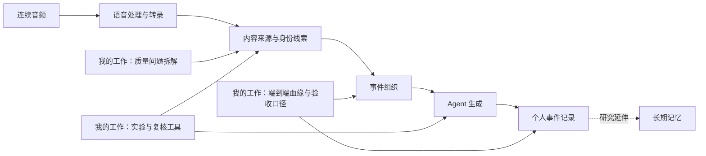

# 可信个人记忆：从连续音频到可追溯的 AI 事件记录

### 多模态 AI 产品 · 质量策略 · 评测工程 · Agent 应用

**我参与了一套连续音频个人记忆系统的质量建设：让 AI 不仅能听懂和总结，更能判断哪些内容属于用户、哪些结论有证据、什么时候应该停止生成。**

这个项目把长时间录音经过语音处理、内容理解、身份归因、事件聚合和 Agent 生成，整理成用户可以阅读的事件记录。我的工作聚焦在这条链路的可信性：识别外放媒体、排查说话人错归、分析无证据生成，并把零散反馈转化为可定位、可比较、可交接的质量改进工作。

## 项目速览

| 维度 | 我在项目中的工作 |
|---|---|
| 面对的问题 | AI 把外放内容、旁人的话或不足以支撑事实的输入，写成用户自己的经历 |
| 我的切入点 | 打通用户反馈、数据标注、模型实验、事件血缘和最终卡片评估 |
| 核心方法 | 分层定义问题、固定样本、控制变量、消融实验、人工复核、端到端多轮回放 |
| 工程产出 | 批量实验与分析脚本、HTML 听审页、标签导入导出、错误追踪页面、系统地图、方案交接包 |
| 工作重点 | 将概率型模型行为转化成可以审查和验证的产品决策 |

## 我做出的关键成果

| 成果 | 具体结果 | 对项目的价值 |
|---|---|---|
| 改进片段级媒体识别 | 同一 116 条复核集上，F1 **75.5% → 84.1%** | 提高对媒体内容的识别能力，同时跟踪正常内容误杀 |
| 验证最终卡片效果 | 固定窗口回放中，R6 → R7 的污染卡片 **7/62 → 5/64** | 把局部模型变化连接到实际生成内容 |
| 拆解无证据生成 | 将 25 条问题样本归为 **4 / 4 / 17** 三类原因 | 区分输入完整性、音频可用性和证据质量，明确不同修复位置 |
| 评估过滤方案的代价 | 发现某质量阈值会拦截 **68.7% 的近似正常对照** | 排除“问题拦得多但正常内容也损失大”的单阈值路线 |
| 建立端到端追踪 | 固定 **17 个窗口 × 5 轮**，关联片段、事件、生成决定和引用 | 解释卡片为什么出现、消失或改变主题 |
| 降低实验与交接复杂度 | 建立听审、结果对齐、批量回放和交互式系统地图 | 让方案比较与问题定位建立在共同证据上 |

数值均为历史固定样本结果。R7 最终污染比例与原始 R0 持平，且部分卡片标签采用继承与复核；详细范围见[成果与指标说明](docs/04-results.md)。

## 我的工作如何连接整条链路

图中是为展示重新绘制的抽象链路。基础音频服务、生成服务和记忆实验属于团队协作背景；我的贡献重点是质量策略、实验分析、评测工具和跨层问题定位。

## 四个代表性案例

### 01｜避免把外放媒体写成用户经历

我先拆开“检测到媒体”和“整段是否应该过滤”，统一样本关联与标注口径，再通过多轮控制变量和消融实验比较方案。最终将媒体识别改进嵌入现有理解任务，并用最终卡片回放继续验证效果。

**看细节 → [媒体污染识别：从标签定义到集成候选](docs/03-experiment-evolution.md)**

### 02｜让说话人线索真正约束生成

我沿着说话人切分、身份匹配、事件输入和卡片叙事追踪错归问题，关注上游“不确定”如何在下游变成“你说过”。据此整理身份透传与叙事归因约束，区分声纹识别问题和最终文案归因问题。

**看细节 → [说话人归因：从识别结果到叙事证据](docs/07-speaker-attribution.md)**

### 03｜建立无证据生成的根因分类与准入方案

我把问题样本拆成元数据、音频可用性与低质证据三类，用问题组和对照组检查质量阈值的实际代价，形成从输入校验到生成后核对的分层方案。

**看细节 → [证据准入：让系统知道何时不该生成](docs/08-evidence-gates.md)**

### 04｜把“模型指标变好”连接到“最终内容变好”

我建立片段—事件—生成决定—引用—卡片的追踪关系，用同窗口多轮回放分析差异，避免只看卡片总数。残余问题最终收敛到一个反复影响生成的上游窗口，为后续切分和语义一致性验证提供方向。

**看细节 → [端到端质量：追踪每张卡片从哪里来](docs/09-end-to-end.md)**

## 我交付了哪些工具与材料

| 交付物 | 核心能力 |
|---|---|
| 样本对齐与指标分析 | 事件与时间联合关联、标签版本管理、混淆矩阵、版本间错误变化 |
| 人工听审页面 | 音频、转录、模型判断、标签同屏；自动保存与 JSON 导入导出 |
| 批量实验工具 | 并发执行、失败重试、阶段缓存复用、只重跑目标理解步骤 |
| 端到端追踪页面 | 关联输入片段、事件候选、生成/跳过、引用集合和卡片标签 |
| 系统地图与交接说明 | 梳理服务边界、数据流、当前实现与实验方向，整理最小改动和验证口径 |

**看细节 → [评测与复核工具](docs/05-evaluation.md) · [系统地图与交接](docs/10-system-map-and-handoff.md)**

## 进一步了解

- 想知道我的职责和能力：[个人贡献与工作方式](docs/01-context-and-scope.md)
- 想看系统怎么工作：[技术架构与跨层证据](docs/02-architecture.md)
- 想了解我如何做技术判断：[方案取舍与问题解决方法](docs/06-lessons-and-limits.md)
- 想快速用于面试或项目沟通：[项目介绍与技术问答](docs/11-project-presentation.md)

本仓库是对外项目作品集。技术说明、示意图和示例均经过重新组织与脱敏；[材料范围说明](PUBLICATION.md)和聚合校验工具用于补充了解，不影响直接阅读项目内容。
