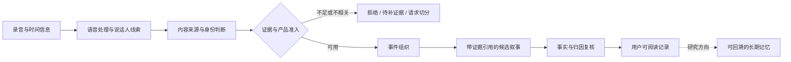

# 从连续音频到可信记忆：质量治理研究复盘

一份已结项项目的原创、脱敏技术复盘。整理日期：2026-10-14。

连续录音能提供大量可转录内容，但“录到了什么”与“用户经历了什么”之间存在很大距离。外放媒体、旁人的讲话、缺失的录音、错误的身份归属，都可能被下游生成模型包装成流畅而不真实的故事。本复盘讨论如何把这些问题拆成可以定位、测试和拒绝的系统行为。

**主要观察：片段级 F1 从 75.5% 提升至 84.1%，并没有带来相对原始基线更低的最终媒体污染卡片比例。** 在同一批固定窗口中，原始基线与最终候选均为 5/64。这个差异提醒我们，局部模型指标与最终产品效果需要分别验证。

## 阅读顺序

| 文档 | 关注的问题 |
|---|---|
| [背景与贡献边界](docs/01-context-and-scope.md) | 为什么研究、哪些属于个人工作、哪些属于团队系统 |
| [抽象架构与证据契约](docs/02-architecture.md) | 音频、身份、事件和长期记忆如何保留证据关系 |
| [方法演进与失败尝试](docs/03-experiment-evolution.md) | 为什么调整提示、检测器或阈值没有直接解决问题 |
| [实验与聚合结果](docs/04-results.md) | 分母、标签来源、指标计算以及结果能支持什么 |
| [端到端评估与误差追踪](docs/05-evaluation.md) | 如何避免标签偏差、重复样本和替代指标误导 |
| [取舍、局限与下一步](docs/06-lessons-and-limits.md) | 未完成什么，若重新研究应优先验证什么 |
| [公开边界与证据说明](PUBLICATION.md) | 哪些材料未公开，哪些结论不能独立复现 |

## 一张图看研究范围



这是为公开复盘重新绘制的概念图，不是内部服务部署图，也不保证对应任一版本的精确执行顺序。

## 可验证内容

`results/` 只包含汇总统计，不含逐用户、逐事件或逐条转录数据。用 Python 标准库即可复核公开指标与文件完整性：

```bash
python3 tools/verify.py
```

该脚本不会运行模型或复现实验。原始数据、私有代码、完整提示、模型调用记录和内部基础设施均不在此仓库；结果不是生产验收或独立外部基准。
