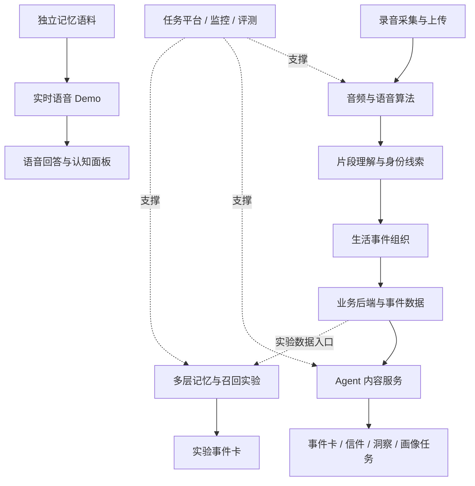

# Spiro｜从日常声音到个人记忆的 AI 平台

**让日常经历成为可以回看、理解和持续对话的个人记忆。**

Spiro 围绕日常音频构建了一套贯通感知算法、事件理解、Agent 内容服务、记忆研究和交互展示的 AI 技术体系。平台从录音中识别语音与说话人，整理有意义的生活事件，再通过事件卡、洞察信件等内容任务，将分散的信息转化为更容易阅读和回看的表达。

项目同时建设了算法运行、异步任务、模型调用、结果校验、监控排障、人工评测和前后端演示工具，使产品体验与底层研发能够围绕同一条数据链路协作。

## 产品希望带来的体验

| 用户需要 | 平台的处理方式 | 内容与交互形态 |
|---|---|---|
| 留住日常中值得记住的片段 | 音频理解、语义筛选、事件合并 | 结构化生活事件与事件卡 |
| 回看一段时间里发生的变化 | 按时间组织事件，提供上下文给内容任务 | 洞察信件、画像和相关任务 |
| 在对话中找到与自己有关的经历 | 按问题类型组织记忆检索与回答 | 实时语音与认知面板 Demo |
| 看懂 AI 为什么这样表达 | 保留片段、事件、引用与运行轨迹 | 内容复核、来源追踪与研发工作台 |

产品设计也探索可穿戴设备作为录音入口；本文重点展示已经留存工程依据的软件平台、算法服务和实验模块。具体硬件量产及客户端商业发布状态不在本材料的确认范围内。

## 六个相互连接的系统板块

| 板块 | 建设内容 | 在整体项目中的作用 |
|---|---|---|
| **音频算法引擎** | 音频处理、语音活动检测、ASR、说话人切分、声纹特征 | 将声音转为带时间与身份线索的可计算数据 |
| **事件理解系统** | 片段语义分析、来源判断、转录校对、事件聚合 | 将零散对话组织为有上下文的生活事件 |
| **Agent 内容平台** | 任务注册、上下文准备、多运行时、结构化输出、业务校验 | 支撑事件卡、信件、洞察及画像等任务 |
| **平台与研发工作台** | API、异步队列、Monitor、实时事件、重试、成本与过程记录 | 支撑服务运行、问题定位和团队协作 |
| **记忆系统研究** | 多层记忆、事实更新、多路召回、四阶段事件卡 | 探索从单次事件走向持续理解的能力 |
| **交互展示与评测** | 实时语音 Demo、认知面板、系统地图、听审与对比工具 | 让能力可体验、链路可解释、结果可检查 |

## 从录音到内容，再到持续记忆

主服务、记忆实验和语音 Demo 的边界分别说明：它们组成项目的完整研发版图，但不被描述为同一套已经全面上线的运行环境。

## 技术建设的四个重点

**从感知到语义的算法组合。** 音频清洗、转录、说话人分析和大模型语义理解分层协作。不同版本在转录时机、声纹匹配位置和模型调用编排上持续演进。

**面向多业务的 Agent 工程。** 任务类型与版本、输入输出契约、模型运行时、上下文和业务守护规则相互分离，支持同一框架承载多种内容产品。

**面向长期理解的记忆探索。** 原始对话、具体事实、事件叙事、前瞻信息和稳定观察分别存储与更新；检索与内容生成保留证据关联。

**贯穿平台的质量验证。** 通过人工听审、固定样本回归、跨版本比较和卡片来源追踪，检查算法变化如何传递到最终体验。

## 已有工程与实验成果

- 音频服务形成六条核心流水线及分层工程结构，覆盖音频、身份、片段、事件和声纹准入。
- Agent 服务形成 API、Consumer、CLI 三类入口，配套任务版本、结构化结果、监控和异常处理。
- 记忆实验形成 L0–L5 数据组织、事实与画像更新、多路召回和四阶段事件卡流程。
- 前后端 Demo 形成语音交互、问题路由、记忆召回、认知展示与会话轨迹记录。
- 研发工具覆盖交互式系统地图、听审标注、批量实验、卡片比较和跨层证据追踪。
- 媒体识别历史固定复核集的 F1 从 **75.5% 提升至 84.1%**；完整端到端结果和样本口径见[评测数据](docs/12-validation-results.md)。

## 深入了解整个项目

| 阅读主题 | 内容 |
|---|---|
| [产品定位与使用场景](docs/01-product.md) | 产品价值、用户旅程、内容形态与典型场景 |
| [整体架构与数据流](docs/02-architecture.md) | 系统边界、核心数据对象、服务协作与六层架构 |
| [音频与语义算法](docs/03-algorithms.md) | 六条流水线、ASR、版本演进、片段与事件理解 |
| [声纹注册与身份体系](docs/04-speaker-identity.md) | 注册准入、匹配、聚类、身份透传与归因 |
| [Agent 内容服务](docs/05-agent-platform.md) | 内容任务、插件机制、上下文、执行器和校验 |
| [平台工程与研发工作台](docs/06-platform-engineering.md) | 异步任务、Monitor、状态、重试、成本与工具 |
| [多层记忆与检索](docs/07-memory.md) | L0–L5、更新、召回、事件卡与实验边界 |
| [实时语音与前端体验](docs/08-live-experience.md) | 全栈 Demo、语音链路、问题路由和认知面板 |
| [质量体系与技术案例](docs/09-quality.md) | 媒体、身份、无证据生成与端到端评测 |
| [工程交付与能力状态](docs/10-delivery.md) | 模块成果、技术栈、工程验证与交付范围 |
| [公司项目介绍文案](docs/11-company-introduction.md) | 官网简介、完整项目介绍与演示讲解顺序 |
| [评测数据与口径](docs/12-validation-results.md) | 历史聚合结果、公式与可复核范围 |

本页为公司项目对外展示材料，基于归档工程重新编写；功能状态以[交付说明](docs/10-delivery.md)为准。公开范围见[材料说明](PUBLICATION.md)。
