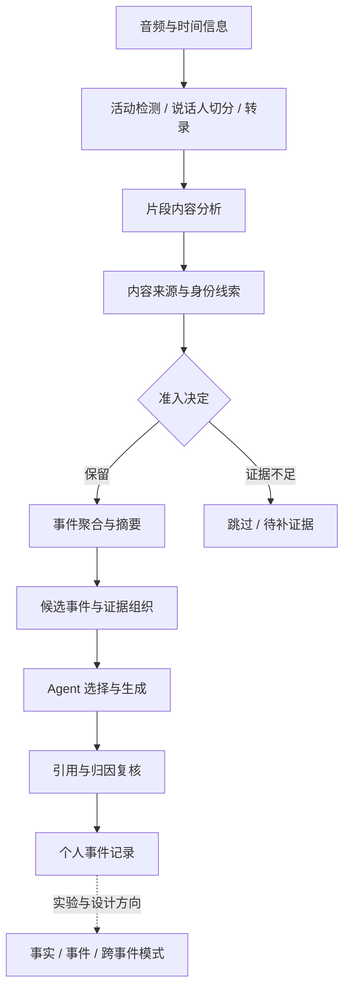

# 技术架构：从录音到个人记录，质量问题发生在哪里

## 先理解主流程

一段音频进入系统后，需要依次形成可分析的声音片段、文本和说话人线索，再组织为事件，最后由生成模型选择内容并完成叙事。长期记忆则在更高抽象层保存和使用这些观察。



这张图表达功能关系，不对应内部部署拓扑或某一版本的严格调用顺序。

## 我重点梳理的三个层间接口

### 音频理解 → 事件组织

这个接口不能只传一段摘要。下游还需要知道片段来自哪里、覆盖什么时间、是否含媒体、说话人归属是否可靠，以及哪些内容已被过滤。

如果只传“发生了什么”，模型可能在摘要阶段就消除不确定性。后面的生成系统即使没有额外编造，也会继承上游已经写错的主题。

### 事件组织 → Agent 生成

事件聚合改变了信息单元：多个片段可能变成一个事件，一段短时但鲜明的媒体内容也可能主导整段摘要。因此我关注生成器实际收到的事件集合，而不只关注单条片段预测。

这个接口需要支持检查候选事件、引用来源、身份线索与生成决定之间的关系。只有知道生成器看到了什么，才能区分是上游输入错误，还是生成器选择或表达错误。

### 单次记录 → 长期记忆

长期归纳应当保留低层证据。原始观察、原子事实、事件摘要、跨事件模式和未来推断，不应该被混成同一种确定程度的内容。

我在系统梳理中区分当前链路、记忆实验与后续设想，让阅读者知道哪些内容有实现依据、哪些仍属于设计方向。

## 公开示意：一份可追踪证据应该表达什么

下面是我为展示方法重新设计的简化结构，不是实际项目的接口或真实样本：

```json
{
  "sample": "synthetic-example-A",
  "span_seconds": [0, 60],
  "audio_available": true,
  "content_origin": "mixed",
  "speaker_assignment": "uncertain",
  "evidence_units": ["synthetic-segment-1"],
  "decision": "needs_review"
}
```

这些概念分别对应输入完整性、内容来源、身份可靠性、引用关系和产品动作。关键在于它们可以独立检查，不把复杂判断压缩成一个不可解释的总分。

## 跨层定位的方法

| 最终现象 | 优先检查 | 需要回答的问题 |
|---|---|---|
| 外部内容成为用户经历 | 来源判断、事件边界、主题选择 | 媒体没被识别，还是识别后仍进入生成？ |
| 旁人的话写成“你说” | 身份候选、输入描述、叙事约束 | 不确定性在哪一步变成了确定归因？ |
| 生成没有发生过的事情 | 输入存在性、转录与陈述对应 | 缺少证据时系统为何仍允许继续？ |
| 版本升级后卡片减少 | 输入集合、聚合与生成决定 | 少的是问题卡片，还是有价值内容？ |

这套定位方式使我能够把问题分配到具体环节，并为不同环节选择不同的验证方法。
