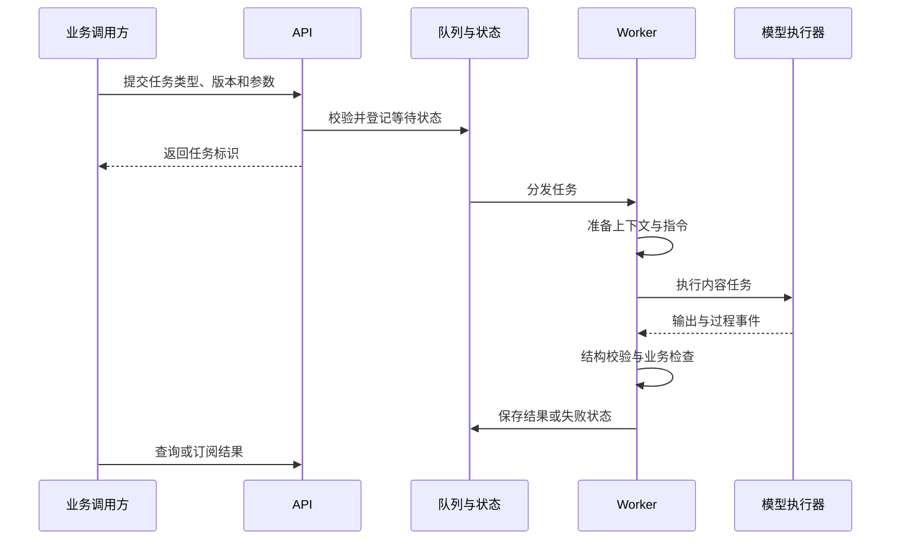

# Agent 内容服务与任务执行框架

[English](en/05-agent-platform.md) · 中文

## 一套框架支持多种内容任务

Agent 服务面向业务提交结构化任务，准备所需上下文，选择运行方式并返回可校验结果。内容策略以任务与版本组织，平台承担公共执行能力。

| 任务类别 | 输入与目标 | 典型处理 |
|---|---|---|
| 多事件卡 | 一组候选事件 | 选择、生成或跳过，并返回引用 |
| 单事件卡 | 事件和历史上下文 | 围绕具体经历生成内容 |
| 洞察信件 | 时间范围及相关事件 | 组织周期性长篇表达 |
| 用户洞察 | 事件及已有卡片等材料 | 提取进一步解释与相关线索 |
| 画像任务 | 时间范围与关注维度 | 整理阶段性观察 |
| 事件选择 | 候选事件集合 | 选择适合进一步消费的材料 |
| Demo 与测试任务 | 实验参数或受控输入 | 比较策略与验证框架行为 |

任务目录说明工程支持范围，不等于每个任务都对应一个已发布的客户端入口。

## 一次任务如何完成

API、Consumer 和 CLI 共用执行核心：API 负责服务集成，Consumer 负责异步执行，CLI 支持本地调试和受控实验。

## 任务插件与版本管理

每种任务包含版本配置、提示模板、输入输出模型和可选 hooks。新增内容任务可以复用上下文、执行、记录与监控能力，将差异集中在材料组织、生成策略及业务规则。

输入模型验证请求；模型输出模型检查生成结构；业务响应模型保持对外契约稳定。内部“生成或跳过”的决定可以通过适配器转换为业务结果，不要求外部系统理解模型内部表达。

## 两类模型运行方式

**工具型 Agent**在任务工作区内读取事件资料，根据索引与工具获取上下文，适合需要主动阅读材料的任务。**单次调用**将选定事件组织到请求中，直接返回结构化结果，适合输入范围明确的任务。任务版本决定运行时，模型通过统一调用层配置。

上下文处理区分用户时间窗缓存和单任务工作区。部分直接调用路径按事件获取材料，并核对事件所属用户；这属于具体路径的工程检查，不被扩大表述为所有任务已经完成统一安全认证。

## 结果校验与业务守护

执行过程包含结构校验、语言要求、生成/跳过规则和输出整理。可重试错误与业务合法的跳过应区别处理。强制重新生成等特定业务条件需要显式规则，避免通过随意修改提示来改变服务契约。

引用标识是追踪基础；引用存在不等于内容真实，因此结构校验之外仍有内容评测。任务成功表示完成了执行契约，产品质量还需结合人工复核与使用场景判断。

三层 Schema、任务执行顺序、Redis Streams 生命周期及 ACK/重试/死信语义见[数据契约与异步运行时](14-contracts-runtime.md)。
