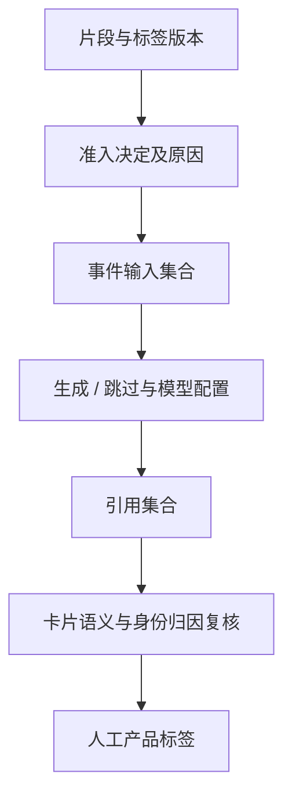

# 端到端评估与误差追踪

## 保留三个独立目标

第一，片段内容识别是否正确；第二，保留/过滤/切分的动作是否符合产品需要；第三，最后生成的叙事是否真实、归因正确且值得记录。三个目标需要各自标签，不能把一个字段同时当作三者的真值。

评估时还要区分“模型给出的答案”和“人类真值”。让模型先解释错误、再让标注者看着解释修改标签，会使评测集朝着模型倾斜。后续验证应保留不展示预测的独立盲标集，并记录分歧处理流程。

## 建立可比对的实验单元

样本身份应包含来源事件及时间范围，不能只靠局部时间戳。每轮至少保存：输入集合版本、标签版本、预测版本、缺失项、关联规则，以及每个样本到生成结果的映射。

对固定窗口做多次运行可以观察随机变化，但重复运行不增加独立内容的数量。希望估计泛化误差，需要新增用户与新录音场景；希望估计生成随机性，则应在相同输入上保留多轮运行。两种设计的目的不同。

## 为什么只比较卡片总数会误导

过滤一个片段可能改变事件合并后的主题、候选集合及生成决策。某版本少生成两张卡，可能是避免两张坏卡，也可能是丢掉两张正常卡，或者多种变化相互抵消。

建议保存如下血缘链：

比较两个版本时，应先确认输入是否相同，再核对哪些片段被拦截、事件集合如何变化、生成决策是否翻转，最后分析实际卡片内容。槽位相同或引用 ID 相同，都不能单独证明文本语义相同。

## 将结构检查与语义检查分开

结构检查包括必填字段、合法引用、有效时间范围和输出格式；语义检查包括陈述是否被证据支持、说话者是否正确，以及是否将媒体内容误作用户经历。两者都重要，但前者通过不能替代后者。

## 本仓库的验证边界

公开脚本只能重新计算聚合指标并核对文件哈希。原始预测、标注过程和音频没有公开，外部读者无法据此重新评测模型。本文也没有补跑训练、模型调用、线上灰度或用户研究；未验证的步骤仍然属于研究计划。
