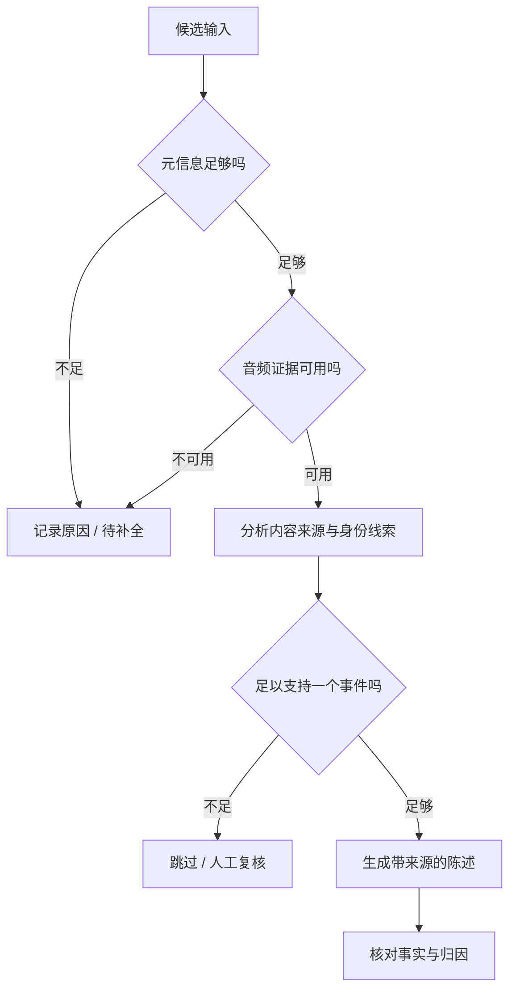

# 案例三：证据准入——让 AI 知道什么时候不该生成

## 问题与我的目标

用户从未经历的事情被写进个人记录，未必全部来自最后一步的语言模型。它可能从一个缺少时间信息的事件开始，也可能来自不存在的音频，或者由错误转录和身份错归逐层放大。

我的目标是拆开这些路径：先明确证据在哪一层失效，再决定应该阻断、补全、复核还是调整生成策略。

## 先把问题样本分层

| 类型 | 样本数 | 我关注的原因 | 对应处理位置 |
|---|---:|---|---|
| 关键元数据问题 | 4 | 事件缺少支持处理的必要信息 | 进入流水线之前 |
| 音频缺失问题 | 4 | 有事件记录但没有可用音频证据 | 音频可用性与任务状态 |
| 低质证据及错误叙事 | 17 | 转录、身份、质量或过度发挥等组合问题 | 理解、归因及生成校验 |

25 条是主动收集的问题样本。这里的价值在于明确修复路径，不代表整个产品中各类问题的发生频率。

## 为什么我没有采用“低音质直接删”

我为音质评分建立了问题样本与近似正常对照的比较。结果显示，某阈值可以拦截 88% 的问题样本，同时会拦截 68.7% 的对照样本。

如果只看前一个数字，会觉得方案有效；加入对照后，就会发现它可能让大量正常内容失去进入产品的机会。因此我把音质看成风险线索，而不是独立的最终裁决。

## 分层处理思路

这是公开概念方案，不表示所有节点都已经作为完整生产功能上线。

### 输入校验

输入存在性与模型质量应分开。如果音频根本不存在，换更强的理解模型没有意义。任务状态应能够表达缺失和失败，避免下游把“有记录”误认为“有证据”。

### 信号与参与线索

人声活动、转录质量、身份匹配和用户发言比例回答不同问题。有人说话不代表是用户；用户说得少不代表没有参与重要事件。联合分析比单独使用某个阈值更符合任务目标。

### 生成前准入

我在候选事件中组织用户参与与归因线索，观察生成器是否选择生成或跳过。26 条候选分成 6 组后，1 组生成、5 组跳过；这帮助我发现策略偏保守，需要进一步检查值得保留的内容。

### 生成后核对

一个合法的引用 ID 只证明引用对象存在。还需要检查该对象是否支持当前陈述，以及被描述的行为是否确实属于用户。结构与语义必须分开验收。

## 我交付的内容

问题样本分类、质量阈值对照、分层准入方案、参与度与归因线索分析，以及生成前选择行为的实验报告。

这些工作把一个笼统的“幻觉问题”转化成不同层次的工程检查项。下一步可在单事件粒度补充应生成/应跳过真值，以更准确地衡量选择性与正常内容损失。
