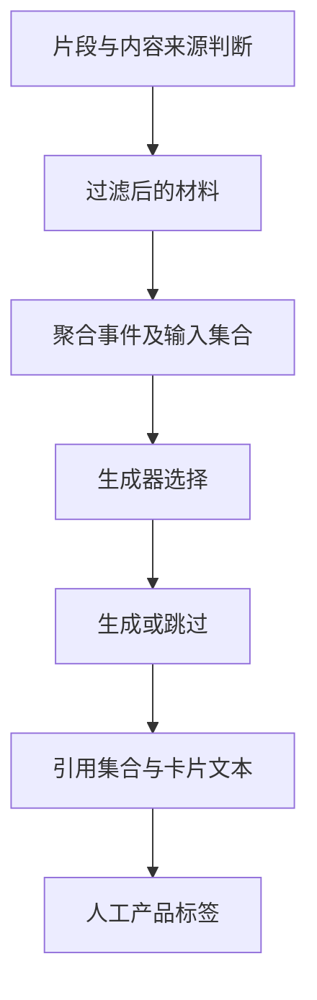

# 案例四：端到端质量——追踪每一张卡片从哪里来

## 为什么我继续追踪下游

片段分类只是中间环节。即使更多媒体片段被识别，事件聚合和生成器仍可能抓住少量残留内容，形成同样的问题卡片。

我把验证对象从分类结果继续推进到实际生成的文本，建立跨层关联，解释“模型变了以后，用户最终看到的内容发生了什么”。

## 我的比较设计

- 固定 17 个窗口，保持输入内容具有可比性。
- 每个窗口运行 5 轮，观察生成选择的变化。
- 同时记录实际生成数量与媒体污染标签。
- 将结果关联到输入片段、候选事件和引用集合。
- 检查生成/跳过翻转，而不只比较最后总数。

重复运行用于观察同输入下的变化，不把 85 个槽位说成 85 个独立用户场景。

## 建立血缘链

这条链能够支持反向排查：从一张问题卡片出发，看它引用了哪个事件，事件保留了哪些片段，片段此前怎样被判断。

## 我如何分析两个版本的差异

| 比较层次 | 具体查看什么 | 对应解释 |
|---|---|---|
| 输入 | 原始窗口是否相同 | 排除场景差异 |
| 片段判断 | 哪些片段被新增保留或过滤 | 定位模型策略变化 |
| 事件候选 | 输入集合与摘要主题是否变化 | 判断聚合造成的放大或重组 |
| 生成决定 | 同窗口是否发生生成/跳过翻转 | 区分内容变化与选择变化 |
| 引用与文本 | 是否同源、语义是否等价 | 防止只按槽位继承结论 |
| 产品标签 | 实际污染与正常内容是否变化 | 回到用户最终体验 |

## 得到的关键观察

R7 的片段 F1 高于 R0，但固定窗口中的媒体污染卡片同为 5/64。R7 相比 R6 少了两张污染卡片，说明集成候选间存在改善；同时，原始基线仍是端到端必须保留的参照。

更有用的发现是：R7 剩余问题集中在一个上游窗口，多轮产生相似污染。表面上是多张坏卡，根因可能集中在同一段高影响输入。

这将下一步工作从“继续全局调规则”收敛到更具体的方向：检查该类混合场景的时间边界、短时内容对事件主题的影响，以及生成陈述是否严格受证据约束。

## 我交付的内容与价值

我建立了固定窗口回放、标签来源记录、引用关系追踪和跨版本变化分析材料。它们帮助回答一张卡为什么生成，以及某项模型优化为什么没有形成同等程度的产品收益。

这项工作体现了我的端到端责任意识：不仅提交一个更好的离线分数，还继续追踪它如何改变最终输出。
