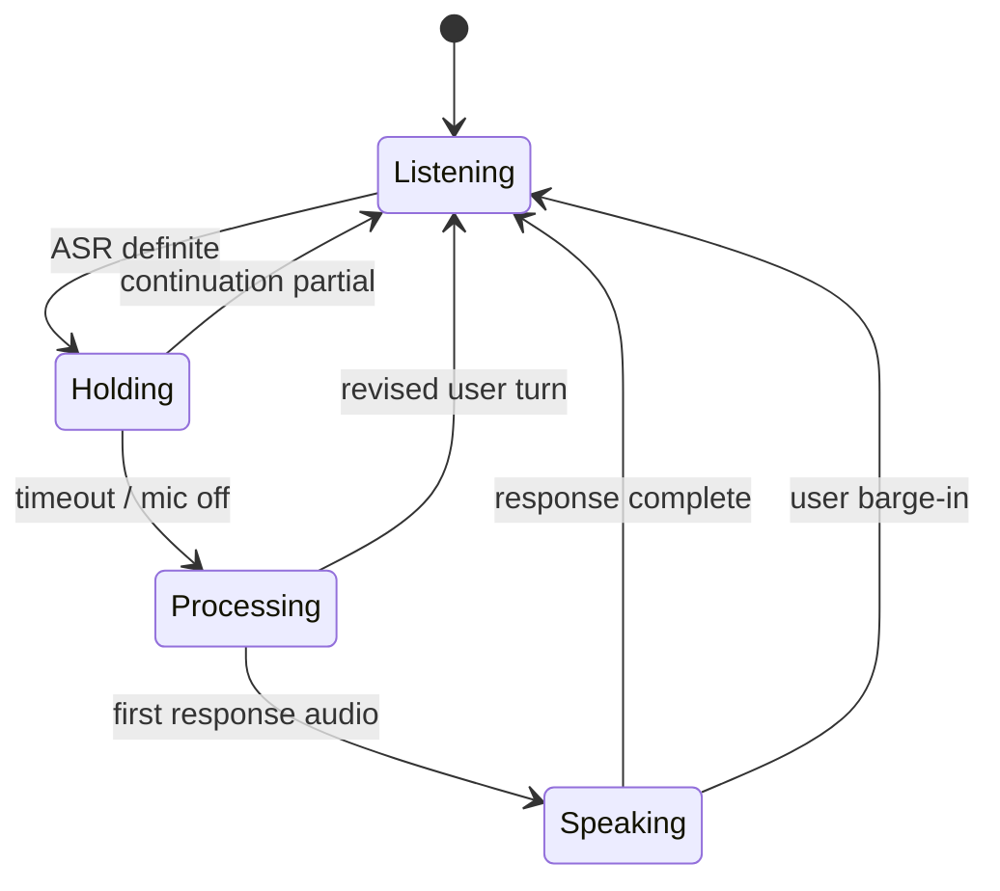

# 实时语音实现细节

[English](en/16-voice-implementation.md) · 中文

## 语音交互是一套状态机

实时语音链路显式维护 `listening → processing → speaking` 三个阶段。ASR partial 用于即时显示和打断判断，definite 表示识别服务确认了一个片段，但不必然表示用户已经说完。

如果把每个 definite 立即提交给 LLM，一句话在自然停顿处可能被拆成多个问题。系统因此维护 Utterance Assembler，将片段和实时 partial 作为界面与提交的单一来源。

## 片段修订与拼接

新的 ASR 文本可能是上一段的扩展、修订，也可能是真正的下一段。组装器根据前缀与规范化公共部分判断：

- 同一段修订时，用更完整版本替换，避免界面重复；
- 无重叠时保留两段，并根据中英文边界决定是否添加空格；
- 提交后原子地取出整段文本并清空组装状态。

轻量完整性规则识别短句、结尾连词和未完成的功能词。规则只决定是否继续等待，不修改用户原话。

## HOLD 窗口

definite 到达后，系统进入短暂 HOLD，给用户续说机会。新的 partial 会取消当前 HOLD 并继续累积；HOLD 到期后即使句子看起来仍未完成也强制提交，避免规则让会话永久卡住。



## Barge-in 与 revision

在助手播报阶段，新的有效用户语音可以触发打断。为减少 TTS 回声误触发，打断需要超过播报开始后的 settle 窗口并达到最小文本长度。

如果模型仍在处理，而用户补充了后半句话，系统保存 pending revision，取消旧轮次，将旧问题与新识别结果去重合并，再作为一个新轮次执行。这样不会静默丢弃用户补充，也不会让旧回答继续写入会话历史。

## 取消顺序为什么重要

打断时先标记 LLM 取消，使半截回复不能进入下一轮的对话上下文；随后立即丢弃待播 PCM、取消生成任务和 TTS，并将状态退回 listening。被取消的轮次保留 revision 所需文本，但不会按正常完成流程清空。

这一顺序处理三个竞态：已经生成但尚未播出的音频、正在流式生成的文字，以及刚到达的用户新语音。仅停止播放器无法解决后两者。

## 拼装语音链路

```text
麦克风 PCM
→ 流式 ASR
→ Utterance Assembler + HOLD
→ 问题路由与记忆召回
→ 中间 LLM
→ 文本分块
→ 流式 TTS
→ 浏览器播放
```

文本分块在保持句子边界的同时尽早启动 TTS，减少等待完整答案后才播报的延迟。另一条 Native Audio 路径由实时模型直接处理语音，其会话协议与拼装链路分开配置。

## 回答与认知面板

查询路由区分 fact、pattern、insight、count 和 temporal。召回和推理形成共享 Answer Pack，语音回复与右侧认知面板从同一来源投影，避免两边分别生成互相矛盾的解释。

## 会话审计

会话目录按轮次记录 ASR、状态、召回、工具调用、打断和完成边界。每次 LLM 调用保存输入与输出，并由 turn 索引连接；音频管线问题查看事件时间线，内容问题查看召回和调用上下文。
