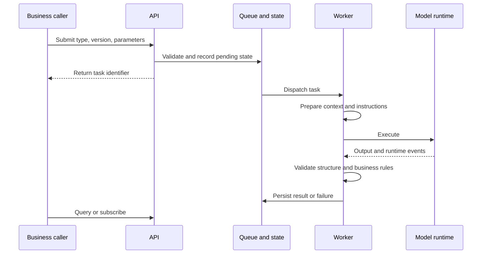

# Agent Content Service and Task Framework

English · [中文](../05-agent-platform.md)

## Multiple content tasks on one execution framework

The service accepts structured tasks, prepares context, selects a runtime, and returns validated results. Content strategies are organized by task and version, while common execution capabilities belong to the platform.

| Task | Input and goal | Processing |
|---|---|---|
| Multi-event card | Candidate event set | Select, generate or skip, return references |
| Single-event card | Event and historical context | Express a particular experience |
| Insight letter | Time range and relevant events | Produce longer-form periodic content |
| User insight | Event and existing card material | Organize further interpretation |
| Profile | Time range and focus dimensions | Summarize observations |
| Event selection | Candidate set | Select material for downstream use |
| Demo and test | Controlled inputs or experimental parameters | Compare strategies and framework behavior |

A registered task does not necessarily correspond to a released client feature.

## Task lifecycle

API, Consumer, and CLI share the execution core. They support integration, asynchronous processing, and local controlled runs respectively.

## Plugins and versions

Each task contains version configuration, templates, input/output models, and optional hooks. New tasks reuse context, execution, recording, and monitoring while defining material preparation, generation strategy, and business rules.

Input models validate requests; model-output models validate generated structures; response models stabilize the external contract. Adapters translate internal produce/skip decisions into business-facing results.

## Two runtime families

A **tool-using Agent** reads event material in a task workspace using indexes and tools. A **single-call runtime** receives selected events directly and returns structured output. Task versions select the runtime, and model configuration passes through the shared invocation layer.

Context handling separates user time-window caches from task workspaces. Certain direct-call paths fetch selected events and verify their user ownership. These specific checks are not presented as a security certification covering every task.

## Validation and guards

Execution includes schema checks, language requirements, produce/skip rules, and formatting. Retryable errors differ from a valid skip. Explicit regeneration rules govern special flows such as forced card generation.

A valid reference identifier enables tracing but does not prove factual accuracy. Successful execution fulfills a task contract; content quality still requires evaluation. See [contracts and asynchronous execution](14-contracts-runtime.md) for examples and failure handling.
