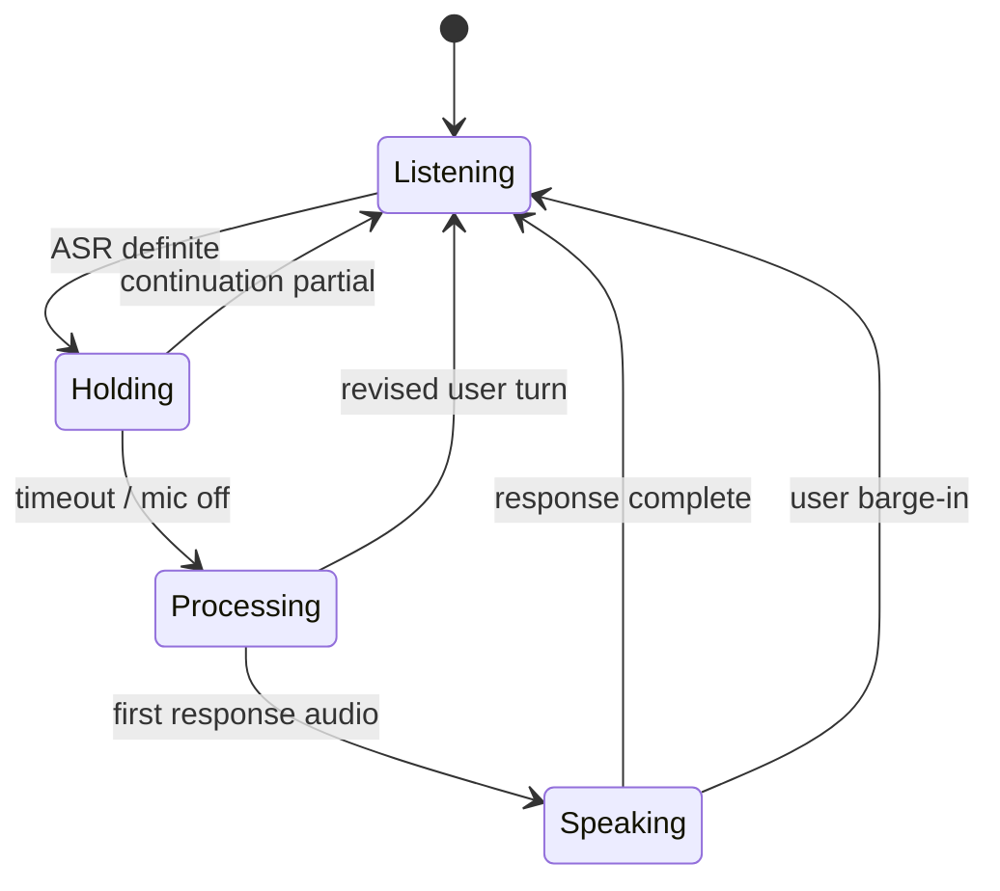

# Realtime Voice Implementation Details

English · [中文](../16-voice-implementation.md)

## Voice interaction as a state machine

The realtime path explicitly maintains `listening → processing → speaking`. ASR partials update the interface and support interruption decisions. An ASR definite marks a recognized segment, not necessarily the end of the user's turn.

Submitting every definite immediately would split natural pauses into separate questions. An Utterance Assembler therefore maintains committed segments and the live partial as one source for both display and submission.

## Revision and concatenation

New ASR text can extend or revise the previous segment, or begin a new one. The assembler compares prefixes and normalized common text:

- a same-segment revision replaces the prior version to avoid duplicated UI text;
- non-overlapping segments are preserved, with spacing based on Chinese or Latin boundaries;
- commit atomically takes the assembled utterance and clears the buffer.

Lightweight completeness rules detect very short phrases, trailing conjunctions, and unfinished function words. They only decide whether to wait; they do not rewrite the user's words.

## HOLD window

After a definite, the system starts a short HOLD window. A new partial cancels HOLD and continues assembly. When HOLD expires, the utterance commits even if it still looks incomplete, preventing heuristic deadlock.



## Barge-in and revision

Valid user speech during playback can interrupt the assistant. To reduce false triggers from TTS echo, barge-in requires a settle interval after speech output begins and a minimum recognized-text length.

If the model is still processing when the user adds information, the system stores a pending revision, cancels the old turn, merges and deduplicates the original query with the new recognition, and executes one revised turn. The additional speech is not silently dropped, and the abandoned answer does not enter conversation history.

## Cancellation order

On interruption, the system first marks the LLM request cancelled so a partial response cannot become context for the next turn. It then drops queued PCM, cancels generation and TTS, and returns to listening. A cancelled turn retains text needed for revision instead of following normal cleanup.

This order handles three races: audio already generated but not played, text still streaming, and new user audio arriving. Stopping the player alone cannot solve the latter two.

## Composed voice path

```text
microphone PCM
→ streaming ASR
→ Utterance Assembler + HOLD
→ query routing and memory retrieval
→ intermediate LLM
→ text chunking
→ streaming TTS
→ browser playback
```

Text chunking respects sentence boundaries while starting synthesis before the entire answer completes. A separate Native Audio path lets a realtime model handle audio directly; its session protocol is configured independently.

## Shared answer and cognition model

Routing distinguishes fact, pattern, insight, count, and temporal requests. Retrieval and reasoning produce a shared Answer Pack from which both spoken output and the cognition panel are projected, reducing contradictions from independent generation.

## Session audit

Per-turn traces record ASR, state, retrieval, tools, interruption, and completion. Each model call stores navigable input and output. Audio failures can be analyzed through the event timeline; content failures through retrieval and model context.
